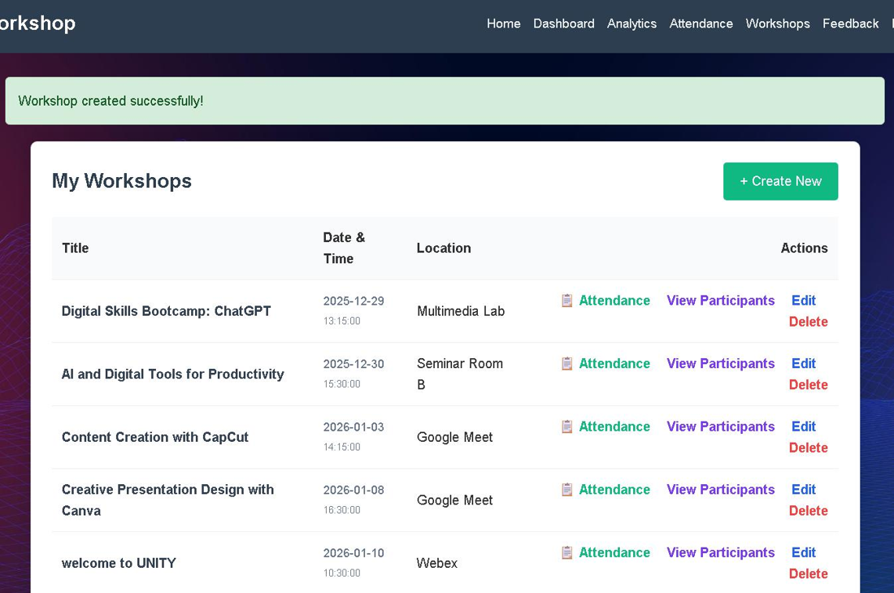

# Digital Skills Workshop Management System

A role-based PHP and MySQL web system for running digital-skills workshops, built by a team of 5 for KP34903 Web Technology at Universiti Malaysia Sabah (2025/26).

## Modules

| # | Module | Used by |
|---|---|---|
| 1 | User authentication and profile (register, login, forgot and reset password) | Everyone |
| 2 | Workshop management (create, edit, schedule) | Organisers |
| 3 | Registration and payment verification | Participants, organisers |
| 4 | Attendance tracking | Organisers, trainers |
| 5 | Learning materials | Trainers, participants |
| 6 | Assignment submission | Participants, trainers |
| 7 | Feedback and certificates | Participants |
| 8 | Reports and analytics dashboard | Organisers |
| 9 | Collaboration: teams and class discussion | Participants, trainers |
| 10 | Notifications and communication | Everyone |

## Tech stack

PHP (mysqli), MySQL, HTML, CSS, JavaScript

## Run it locally (XAMPP)

1. Copy this folder into `htdocs` and start Apache and MySQL in XAMPP.
2. In phpMyAdmin, create a database called `workshop_database` and import `database/workshop_database.sql`.
3. Check the connection settings in `include/db_connect.php` (default: `root` with no password on localhost).
4. Open `http://localhost/workshop-management-system/` and log in with a demo account.

Demo accounts (password `demo1234` for all):

| Role | Email |
|---|---|
| Organiser | `user5@example.com` |
| Trainer | `user2@example.com` |
| Participant | `iloveolaf@example.com` |
| Admin | `admin@smartworkshop.com` |

The payment QR in `img/duitnow_qr.jpg` is a placeholder.

## Security notes

Passwords are hashed with `password_hash`, and most queries use prepared statements. A few older queries still build SQL strings directly; moving them to prepared statements is the next improvement.

## Team

Built by a team of 5 UMS students for KP34903 Web Technology.
